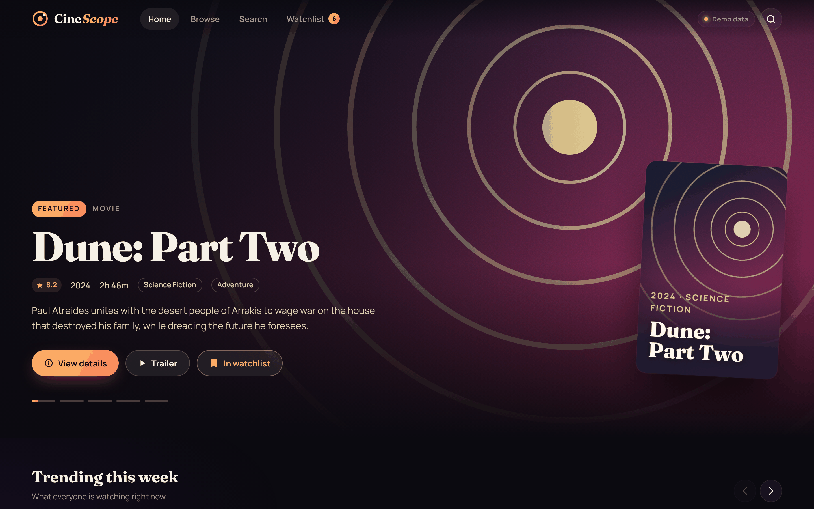
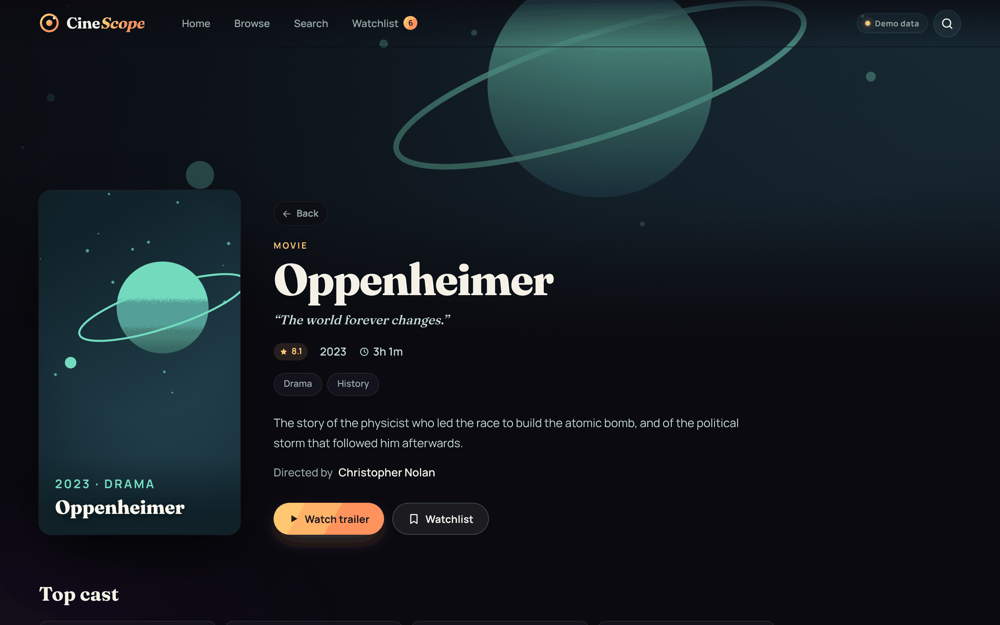
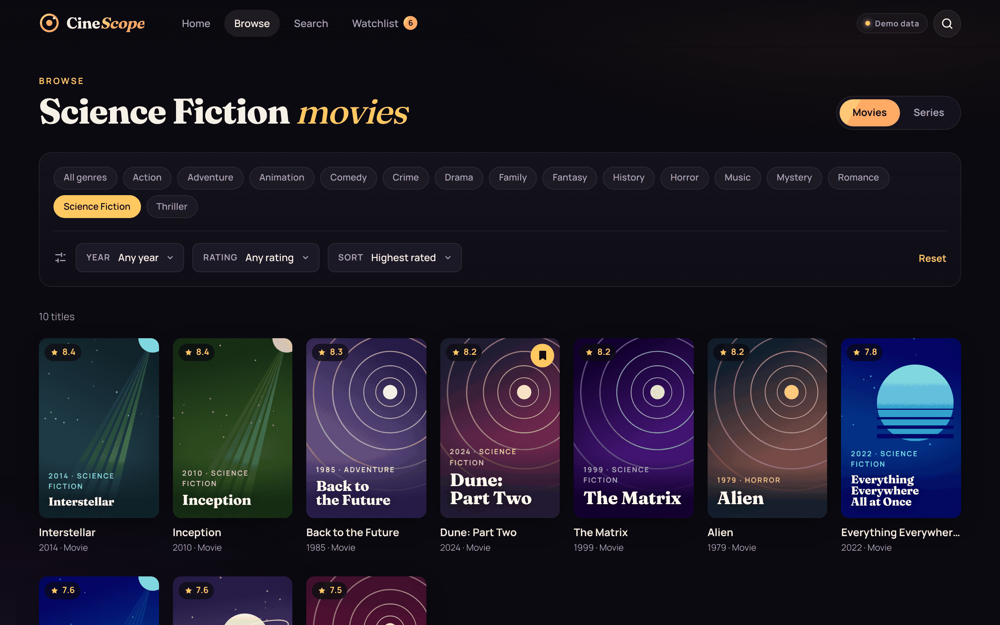
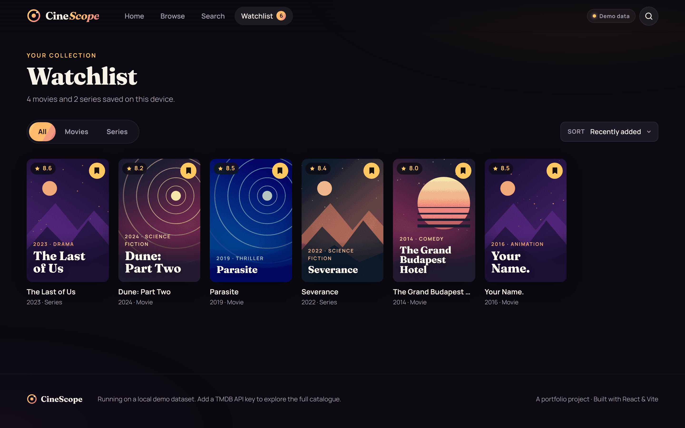
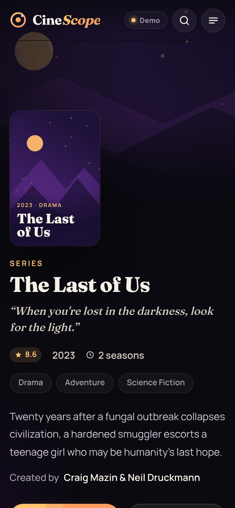

# CineScope

**A cinematic movie & TV discovery app: browse what's trending, filter by genre, year and rating, dig into the details, and keep a personal watchlist.**

It uses live data from [TMDB](https://www.themoviedb.org/) when you add an API key. Without a key it switches to a built-in **demo mode** with a local dataset and generated poster art, so the app always runs and looks complete.



| Title details | Browse & filter |
| --- | --- |
|  |  |

| Watchlist | Mobile |
| --- | --- |
|  |  |

## Features

- **Home page**: a featured hero that rotates on its own (pauses on hover, has progress-bar dots), plus horizontal rows (Trending, Top rated, and one per genre) with scroll-snap and arrow buttons that switch off at the ends of the row.
- **Search**: debounced search (400 ms) that keeps the query in the URL (`/search?q=dune`). In demo mode it also matches cast and director names.
- **Browse**: filter by Movies/Series, genre, decade and minimum rating, and sort by popularity, rating, date or title. All filters live in the URL, so you can share or bookmark a filtered view.
- **Detail page**: backdrop, poster, tagline, runtime or seasons, genres, director/creator, cast list, a "More like this" row, and a **trailer button** that opens a YouTube search.
- **Watchlist**: add or remove titles from any card, the hero or the detail page. The list is saved in `localStorage` and the navbar shows a live count. You can filter it by type and sort it.
- **Generated poster art**: every title gets its own poster drawn locally with SVG and CSS. The colours and motif come from a hash of the title's id, so a title always gets the same poster. The same art appears whenever a real TMDB image fails to load.
- **Demo mode**: 44 well-known movies and shows in a JSON file, served through the same `api` interface as TMDB. A small "Demo data" pill in the navbar shows when it's active.
- **Polished states**: shimmer skeleton loaders, empty states, error states with retry, a 404 page, and a "title not found" page.
- **Responsive**: tested at 390 px (mobile) and 1440 px (desktop). On mobile the navbar becomes a full-screen menu.
- **Accessibility details**: semantic landmarks, `aria-pressed`/`aria-label` on toggle buttons, visible focus rings, and support for `prefers-reduced-motion`.

## Tech stack

| Tool | Why I chose it |
| --- | --- |
| **React 18** | Function components and hooks keep each piece of UI small and easy to reason about. |
| **Vite** | Starts instantly, has fast hot reload, and needs almost no config. Env variables (`VITE_*`) are built in. |
| **React Router 6** | Real URLs for every page, including search queries and filters, so the back button and sharing work. |
| **Plain CSS (one file per component)** | No build-time magic to explain. CSS variables act as design tokens, and container-query units scale the poster typography. |
| **Context + `useLocalStorage`** | The watchlist is the only global state. Context is enough for it, so I didn't need Redux. |
| **Google Fonts: Fraunces + Manrope** | A characterful serif for headlines and a clean sans-serif for the UI. Fallback fonts are defined in case the fonts can't load. |

There are no other runtime dependencies. Icons, the logo and all poster art are inline SVG.

## Project structure

```
cinescope/
├── docs/screenshots/        # README images
├── public/favicon.svg
├── src/
│   ├── api/
│   │   ├── index.js         # picks TMDB or demo; documents the shared interface
│   │   ├── tmdb.js          # TMDB requests + normalizing to our "Title" shape
│   │   ├── demo.js          # same functions, backed by the local JSON
│   │   └── errors.js        # NotFoundError (404 vs. network error)
│   ├── data/demo-titles.json
│   ├── hooks/
│   │   ├── useFetch.js      # { data, loading, error, retry } for any async call
│   │   ├── useDebounce.js
│   │   ├── useLocalStorage.js
│   │   └── useDocumentTitle.js
│   ├── context/WatchlistContext.jsx
│   ├── components/          # Navbar, Hero, Row, TitleCard, GeneratedArt, ArtImage,
│   │                        # Skeletons, CastList, StateMessage, WatchlistButton...
│   ├── pages/               # Home, Search, Browse, Detail, Watchlist, NotFound
│   ├── utils/               # art.js (hash -> palette/motif), format.js
│   ├── styles/global.css    # design tokens, buttons, shared bits
│   ├── App.jsx              # routes
│   └── main.jsx
├── .env.example
├── index.html
└── vite.config.js
```

## How to run

Requires **Node 18+**.

```bash
npm install
npm run dev        # http://localhost:5102
```

Production build:

```bash
npm run build
npm run preview    # http://localhost:5102
```

### Using live TMDB data (optional)

1. Create a free account at [themoviedb.org](https://www.themoviedb.org/signup).
2. Go to **Settings → API** ([direct link](https://www.themoviedb.org/settings/api)), request an API key (choose "Developer"), and fill in the short form.
3. Copy the **"API Key (v3 auth)"** value.
4. In the project folder, run `cp .env.example .env` and paste the key:
   ```
   VITE_TMDB_API_KEY=your_key_here
   ```
5. Restart `npm run dev`. The "Demo data" pill disappears and real posters load.

If there is no key, the app runs in demo mode automatically. Nothing else needs changing.

> Note: a `VITE_` variable is bundled into the frontend, so anyone using the site can see it. That's fine for a free, read-only TMDB key in a portfolio project. A production app would route requests through a small backend instead.

## What I learned

> Built with AI assistance (Claude). I planned the features, reviewed the code, tested it, and customized the design.

- **Working with a real API.** I fetched movies and TV shows from the TMDB API and turned their different fields into one simple shape, so every card shows data the same way.
- **Custom hooks.** I used hooks like `useFetch` (loading, error and data states), `useDebounce` (wait until the user stops typing before searching) and `useLocalStorage` (save the watchlist).
- **Search in the URL.** The search text and filters are saved in the URL, so a user can share a link and the other person sees the same results.

## ملخص بالعربي

**CineScope** تطبيق ويب لاكتشاف الأفلام والمسلسلات، مبني باستخدام React وVite وReact Router. يعرض التطبيق صفحة رئيسية فيها عرض مميز يتبدّل تلقائياً، وصفوفاً أفقية للأعمال الرائجة والأعلى تقييماً وحسب النوع. ويتضمن صفحة بحث بتأخير ذكي (debounce)، وصفحة تصفّح مع فلاتر للنوع والسنة والتقييم والترتيب، وصفحة تفاصيل فيها طاقم التمثيل وأعمال مشابهة وزر لمشاهدة الإعلان على يوتيوب، إضافةً إلى قائمة مشاهدة تُحفظ في المتصفح.

يعمل التطبيق ببيانات TMDB الحقيقية عند إضافة مفتاح API مجاني في ملف `.env`. وبدون مفتاح ينتقل تلقائياً إلى "وضع العرض التجريبي"، فيستخدم بيانات محلية لـ44 عملاً مشهوراً مع ملصقات تُولَّد برمجياً بـSVG. التشغيل: `npm install` ثم `npm run dev` على المنفذ 5102.
